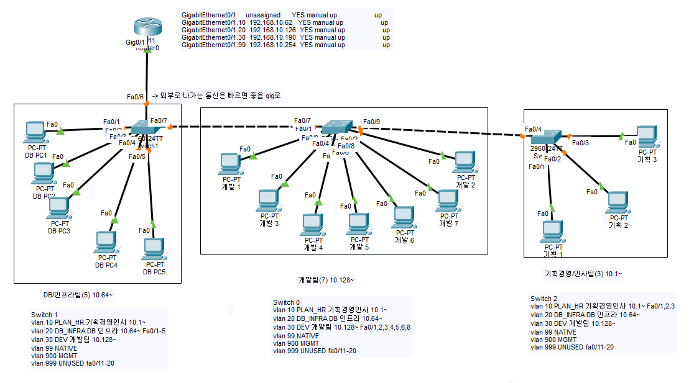

# 3일차 작업 계획서

- 날짜: 2026-11-07

## 1. 목표

- 각 부서 내부에서 네트워크 통신이 가능하도록 IP 할당 및 서브네팅
- VLAN을 활용한 망 분리 및 보안 설정
- 용도별로 VLAN 망을 분리하는 작업

## 2. 작업 대상

| 대상 | 무엇을 |
|------|--------|
| HQ-SW2  | 쓰지 않는 포트 닫기, 기본 잠금, VLAN, 트렁크, 관리 주소          |
| HQ-SW3  | 쓰지 않는 포트 닫기, 기본 잠금, VLAN, 트렁크, 관리 주소          |
| HQ-SW1      | 쓰지 않는 포트 닫기, 기본 잠금, VLAN, 트렁크, 포트 배정, 트렁크 두 곳, 관리 주소 |
| HQ-R1       | Gi0/1의 주소를 서브인터페이스 네개로 옮기기             |
| PC 15대       | 기획경영/인사팀(3), DB/인프라팀(5) ,개발팀(7)                |
|    | 설계표에 VLAN 칸, 구성도 첫 판                     |

## 3. 작업 내용

1. Subnet ID 1 = 10, 2 = 20, 3 = 30 VLAN 생성
2. 인트라 관리를 위한 VLAN 99, 999, 900을 추가 생성
3. 999(UNUSED) VLAN 활용해서 포트 보안을 설정
4. 99(NATIVE) VLAN으로 각 부서별 스위치에 VLAN 설정을 공유(trunk) 설정을 진행
5. SW1 > R1 인터페이스에 trunk 설정을 통해 VLAN 설정을 적용, R1에 가상 인터페이스를 생성하여 10, 20, 30 VLAN이 서로 통신이 가능하도록 설정
6.VTP 설정으로 SW1 = server, SW2.3 = client 설정을 적용해서 VLAN 태그 설정을 서로 공유하도록 만듬.

## 4. 확인 방법

| 확인할 것 | 방법 | 기대하는 결과 |
|-----------|------|---------------|
| 포트가 VLAN에 들어갔다      | `show vlan brief`            | 부서별 포트 목록, 트렁크는 목록에 없음           |
| 트렁크가 섰다             | `show interfaces trunk`      | Gi0/1, Gi0/2 trunking, 허락한 VLAN만 |
| 같은 VLAN이 두 스위치를 건넌다 | 기획경영/인사-PC1에서 기획경영/인사-PC3으로 ping | Reply                            |
| 다른 VLAN은 라우터를 지난다   | 기획경영/인사-PC1에서 DB-PC1으로 tracert | 첫 줄이 192.168.10.1                |
| 주소를 바꿔도 못 넘어간다      | DB-PC1을 영업팀 대역 주소로 바꾸고 ping  | Request timed out                |
| 관리 접속               | Admin-PC에서 두 스위치로 telnet     | 비밀번호 창                           |
| VLAN이 설정 텍스트에 남는다   | `show running-config`        | `vlan 10` 줄                      |

## 5. 되돌리는 방법

- 저장 전이면 `reload` 에서 저장하지 않음(no)
- 라우터가 꼬이면 `configs/HQ-R1.txt` 의 2일차 설정을 붙여 넣는다
- 패킷트레이서 파일은 `git restore configs/network.pkt` 로 마지막 커밋의 판으로 돌아간다

## 6. 결과 

- 한 일: 토폴로지 구성 후 ip할당, 서브네팅 완료, 서브넷팅을 통해 각 부서별 IP 할당 표 제작

- 확인 결과:  
- 막힌 곳과 어떻게 풀었나: 라우터에서 각각 연결했던 스위치를 연결 해제 한 후, 스위치끼리 연결하고 스위치 1번만 라우터에 연결하여 trunk로 스위치 모두 통신이 가능하도록 하여야 했으나 trunk설정에서 문제가 발생. trunk 하여야 하는 vlan을 mode access 하고 default-gateway도 설정을 잘못하여 각각 수정함
- 다음 회차에 이어서 할 일: 라우터 설정(개발 팀에서만 라우터에 접속 가능하게), 스위칭 VLAN