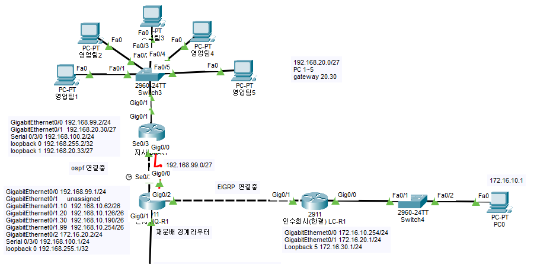
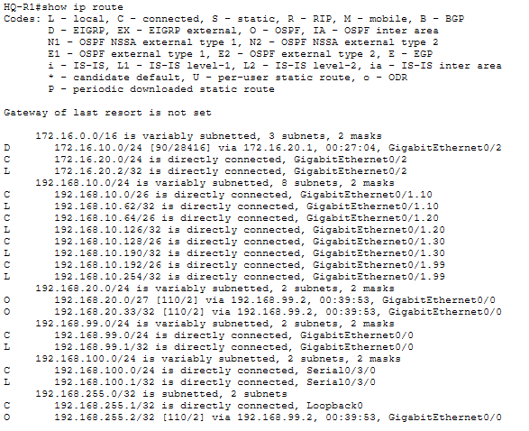
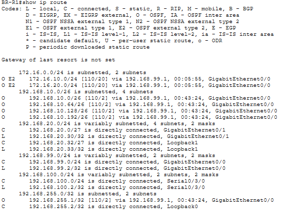
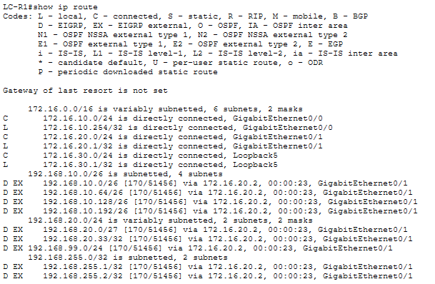

# 7일차 작업 계획서

- 날짜: 2026-11-28

## 1. 목표

- 회사를 하나 인수했다. ( 한결물류 = EIGRP 망 )
- 한결물류에서 MW금융의 주문 관리 서버를 쓸 수 있게 이어준다. ( EIGRP = OSPF 재분배 )
- 라우팅 관련 : 한결물류 > MW 금융 에 필요한 라우팅 테이블만 전달, 한결물류에서 MW금융으로 전달한 경로표 (라우팅 테이블)이 MW금융의 라우팅 테이블을 훼손하지 않게 설정한다.

## 2. 작업 대상

| 대상 | 무엇을 |
|------|--------|
| LC-R1, LC-SW1, LC-PC1| 인수한 회사의 장비 그대로    |
| HQ-R1 | Gi0/2 LC-R1 연결, EIGRP 20, 양방향 재분배, 경로 필터, EIGRP 인증 |

## 3. 작업 내용

1. 한결물류의 토폴로지 작성
2. HQ-R1에 LC-R1 연결 (Gi0/2 EIGRP 20)
3. 양방향 재분배
4. 라우팅 테이블로 받을 것과 전달할 것을 구분(시뮬레이터 문제로 인해 미실습_gns3가능)
5. 연결 구간을 인증으로 보안한다.

## 4. 확인 방법
| 확인할 것   | 방법                    | 기대하는 결과                         |
| ----------------- | ------------------------------------------------------- | --------------------------------------------------------------------- |
| EIGRP 이웃   | `show ip ospf neighbor`     | 172.16.20.2             |
| 지사가 한결물류를 안다         |  BR-R1 `show ip route ospf` |  `O E2 172.16.10.0/24`  |
| 인증이 맞다 | 인증 뒤 'show ip eigrp neighbors' | 이웃이 그대로 |

## 5. 되돌리는 방법

- 재분배가 꼬이면 `no redistribute ...` 로 그 줄만 지운다
- 필터를 잘못 걸어 경로가 다 사라지면 `no distribute-list ...` 를 입력하고, `redistribute` 의 `route-map` 을 빼고 다시 건다
- 한결물류와의 연결을 끊어야 하면 HQ-R1 Gi0/2를 `shutdown` 한다. 새봄상사 망은 영향을 받지 않는다

## 6. 결과

- 확인 결과: 

- 막힌 곳과 어떻게 풀었나: 
- 다음 회차에 이어서 할 일: 